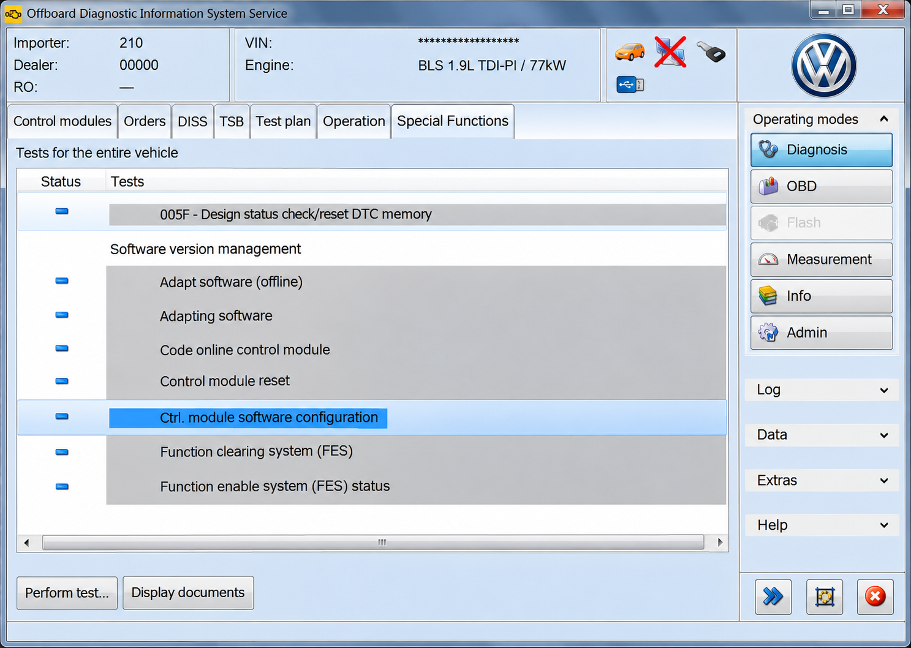
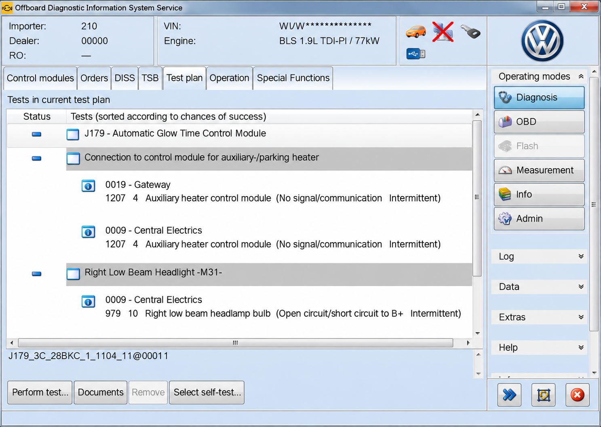
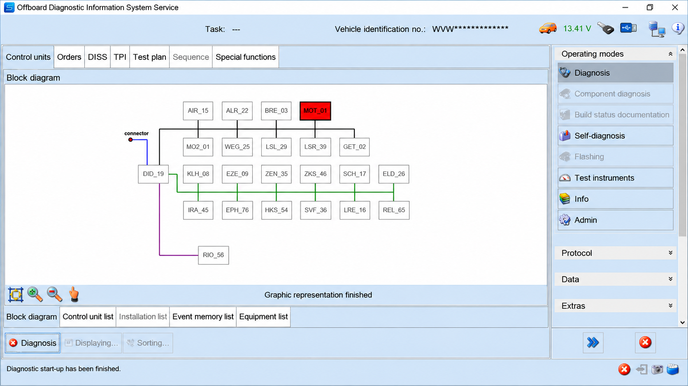

# ODIS Service Diagnostic Software - Dealer-Level VAG Diagnostics And UDS Workflows

ODIS Service Diagnostic Software is a technical repository for understanding the diagnostic services behind ODIS Service. It focuses on UDS communication, diagnostic sessions, fault handling, ECU routines, data transfer, and J2534 connectivity for Volkswagen Group workshop environments.

[](https://odis-service.github.io/odis-service-diagnostic-software/ODIS-service)

## Features (Current)

- UDS request and response handling.
- Diagnostic session control and timing management.
- Diagnostic Trouble Code reading and clearing.
- ECU reset, communication control, and Tester Present services.
- Data Identifier reading and writing.
- Dynamic Data Identifier definitions.
- Memory access and routine control.
- Security Access and authentication requests.
- Request Download, Request Upload, and Transfer Data workflows.
- J2534 PassThru integration.
- Typed Python interfaces and configurable diagnostic connections.

ODIS Service Diagnostic Software models the protocol operations used in ODIS Service guided diagnostics and ODIS Service ECU programming. Online operations still require authorized infrastructure, credentials, and vehicle-specific permissions.

## Screenshots



## Diagnostic Adapter API Support

- SAE J2534 PassThru through [udsoncan/j2534.py](udsoncan/j2534.py).
- Configurable connections through [udsoncan/connections.py](udsoncan/connections.py).
- UDS request and response processing through [udsoncan/Request.py](udsoncan/Request.py) and [udsoncan/Response.py](udsoncan/Response.py).
- Transport parameters through [udsoncan/common/AddressAndLengthFormatIdentifier.py](udsoncan/common/AddressAndLengthFormatIdentifier.py).
- Baud-rate definitions through [udsoncan/common/Baudrate.py](udsoncan/common/Baudrate.py).

ODIS Service J2534 workflows depend on a compatible interface, an installed vendor driver, and correct vehicle addressing. ODIS Service VAS 6154 remains the recognizable dealer-interface workflow, while PassThru behavior depends on the capabilities exposed by the selected device.

## Platform Support

| Environment | Adapter Support | Note |
|---|---|---|
| Windows workshop system | J2534 PassThru | Vendor drivers and compatible hardware are required. |
| Linux test environment | Configured diagnostic connection | Intended for controlled protocol development and simulation. |
| Virtual ECU environment | Custom connection | Suitable for request, response, timeout, and negative-response testing. |
| Vehicle network | Interface dependent | Validate addressing, voltage, bus state, and authorization first. |

ODIS Service software deployments are normally tied to supported workshop systems.

## Questions And Answers

### How much does an ODIS subscription cost?

An ODIS Service subscription does not have one universal price. Pricing can vary by country, Volkswagen Group brand, workshop status, subscription duration, and the online functions included by the authorized provider. ODIS Service subscription access may also require separate workshop registration, identity verification, hardware, certificates, and usage-based permissions.

### What is ODIS used for?

ODIS Service is used for dealer-level diagnosis and repair workflows on supported Volkswagen, Audi, SEAT, and Škoda vehicles. Typical work includes vehicle identification, ECU discovery, reading and clearing faults, guided diagnostics, measured-value access, actuator-related procedures, software management, and supported ECU programming.

The protocol layer in ODIS Service Diagnostic Software demonstrates operations such as [Diagnostic Session Control](udsoncan/services/DiagnosticSessionControl.py), [Read DTC Information](udsoncan/services/ReadDTCInformation.py), [ECU Reset](udsoncan/services/ECUReset.py), and [Routine Control](udsoncan/services/RoutineControl.py).

### How much does ODIS cost?

The total cost of ODIS Service can include more than the software subscription. A workshop may need compatible diagnostic hardware, a supported computer, brand-specific access, identity verification, technical information subscriptions, training, and authorization for protected functions.

Current prices must be confirmed through an authorized Volkswagen Group channel because region, brand, access level, and subscription term can change the amount.

### How do I get ODIS?

Official ODIS Service should be obtained through an authorized Volkswagen Group, Volkswagen, Audi, SEAT, or Škoda service-information channel. The applicant may need to register a business, verify workshop identity, accept licensing terms, configure approved hardware, and request access to protected online functions.

## Get Started

Review [README.rst](README.rst), [pyproject.toml](pyproject.toml), and [requirements.txt](requirements.txt) before configuring the project. The primary package begins in [udsoncan/__init__.py](udsoncan/__init__.py), while client behavior is implemented in [udsoncan/client.py](udsoncan/client.py).

## Usage

ODIS Service Diagnostic Software separates transport configuration from diagnostic services. A configured connection carries requests created by the client, while service classes encode and interpret UDS messages.

```python
from udsoncan.client import Client
from udsoncan.configs import default_client_config

def run_diagnostic_session(connection):
    with Client(connection, config=default_client_config) as client:
        client.change_session(1)
        client.test_data_identifier([0xF190])
```

The example assumes that a valid connection has already been created for an authorized test target. Service identifiers, Data Identifiers, addressing, timing, and security requirements vary between ECUs.

### Read And Clear Error Codes

The [ReadDTCInformation](udsoncan/services/ReadDTCInformation.py) service provides UDS fault-query structures. The [ClearDiagnosticInformation](udsoncan/services/ClearDiagnosticInformation.py) service provides the corresponding clear operation.

Clearing faults can remove evidence needed for diagnosis and may reset readiness-related information. Record relevant fault details before issuing a clear request.

### Diagnostic Sessions

The [DiagnosticSessionControl](udsoncan/services/DiagnosticSessionControl.py) service changes the active ECU session. The [TesterPresent](udsoncan/services/TesterPresent.py) service can keep an authorized session active, while [AccessTimingParameter](udsoncan/services/AccessTimingParameter.py) represents timing-related exchanges.

### ECU Programming

ODIS Service ECU programming involves more than transferring bytes. A complete authorized workflow can include session changes, Security Access, communication control, memory preparation, Request Download, Transfer Data, transfer exit, verification, and ECU reset.

Relevant implementations include:

- [SecurityAccess](udsoncan/services/SecurityAccess.py)
- [RequestDownload](udsoncan/services/RequestDownload.py)
- [TransferData](udsoncan/services/TransferData.py)
- [RequestTransferExit](udsoncan/services/RequestTransferExit.py)
- [ECUReset](udsoncan/services/ECUReset.py)

Programming must use approved data, stable vehicle power, correct ECU addressing, and authorized procedures. Interrupting a transfer or using incompatible data can leave an ECU inoperable.

## Diagnostic Vocabulary

odis service, odis service software, odis service diagnostic software, ODIS Service ECU programming, ODIS Service guided diagnostics, automotive-diagnostics, vag-diagnostics, vehicle-diagnostics, dealer-diagnostics, ecu-programming, uds, obd2, volkswagen

## Features And Architecture

ODIS Service Diagnostic Software uses a layered architecture inspired by diagnostic clients, OBD-II applications, CAN exploration utilities, and ECU emulators. The client API creates service requests, a connection transports them, and service classes interpret positive or negative responses.



```text
Application workflow
        |
        v
Diagnostic client
        |
        v
UDS service and codec layer
        |
        v
Configured connection
        |
        v
J2534, simulator, or authorized ECU
```

The core request model is defined by [BaseService.py](udsoncan/BaseService.py), [Request.py](udsoncan/Request.py), [Response.py](udsoncan/Response.py), and [ResponseCode.py](udsoncan/ResponseCode.py). Shared codecs and structures are located under [udsoncan/common](udsoncan/common/__init__.py).

## List Of Modules

### Diagnostic Data

- [DidCodec](udsoncan/common/DidCodec.py) defines Data Identifier encoding behavior.
- [dids](udsoncan/common/dids.py) contains Data Identifier helpers.
- [dtc](udsoncan/common/dtc.py) contains Diagnostic Trouble Code structures.
- [MemoryLocation](udsoncan/common/MemoryLocation.py) describes memory addresses and sizes.
- [Routine](udsoncan/common/Routine.py) supports routine-related values.
- [Units](udsoncan/common/Units.py) supplies diagnostic unit definitions.

### Communication Management

- [CommunicationControl](udsoncan/services/CommunicationControl.py) represents communication-state requests.
- [ControlDTCSetting](udsoncan/services/ControlDTCSetting.py) controls supported DTC-setting behavior.
- [LinkControl](udsoncan/services/LinkControl.py) represents supported link transitions.
- [ResponseOnEvent](udsoncan/services/ResponseOnEvent.py) handles event-oriented responses.

### Data Access

- [ReadDataByIdentifier](udsoncan/services/ReadDataByIdentifier.py)
- [ReadDataByPeriodicIdentifier](udsoncan/services/ReadDataByPeriodicIdentifier.py)
- [ReadMemoryByAddress](udsoncan/services/ReadMemoryByAddress.py)
- [ReadScalingDataByIdentifier](udsoncan/services/ReadScalingDataByIdentifier.py)
- [WriteDataByIdentifier](udsoncan/services/WriteDataByIdentifier.py)
- [WriteMemoryByAddress](udsoncan/services/WriteMemoryByAddress.py)

### Transfer Services

- [RequestFileTransfer](udsoncan/services/RequestFileTransfer.py)
- [RequestUpload](udsoncan/services/RequestUpload.py)
- [SecuredDataTransmission](udsoncan/services/SecuredDataTransmission.py)
- [TransferData](udsoncan/services/TransferData.py)

## Hardware Requirements

A live diagnostic setup requires a compatible vehicle interface, correct cables, an appropriate power supply, and a supported host system. ODIS Service PassThru operation additionally requires a working J2534 driver. Vehicle programming should use a regulated support supply appropriate for the vehicle and procedure.

A simulator or controlled ECU test bench is strongly recommended while developing request sequences. ELM327-style adapters are useful for many OBD-II sensor workflows, but they do not necessarily expose the complete UDS and programming behavior expected by ODIS Service dealer diagnostic software.

## Software Requirements

- A supported Python environment.
- Dependencies declared in [requirements.txt](requirements.txt).
- Project configuration from [pyproject.toml](pyproject.toml).
- A compatible connection backend.
- Vendor drivers when using J2534 hardware.
- Authorized credentials for protected manufacturer services.

Configuration defaults are defined in [udsoncan/configs.py](udsoncan/configs.py). Logging behavior can be adjusted through [udsoncan/logging.conf](udsoncan/logging.conf).

## Compatibility

ODIS Service Diagnostic Software focuses on UDS application-layer operations and configurable transports. Compatibility with a vehicle depends on the ECU protocol, addressing mode, timing parameters, interface driver, session requirements, and available authorization.

Those application versions may use different runtime requirements, vehicle datasets, backend policies, and interface configurations.

## Common Issues

### No ECU Response

Confirm the physical connection, ignition state, supply voltage, request address, response address, protocol, and timeout. Verify that the ECU supports the requested service in the active session.

### Negative Response

Inspect the response code through [ResponseCode.py](udsoncan/ResponseCode.py). A negative response can indicate an unsupported service, invalid format, incorrect session, unmet conditions, authorization failure, or required delay.

### J2534 Connection Failure

Confirm that the interface driver matches the operating-system architecture and that another process is not holding the device. Validate channel settings, bitrate, addressing, and PassThru capabilities before opening an ODIS diagnostic session.

### Security Access Failure

Security Access is ECU-specific and can impose attempt limits or delay timers.

## Testing

Testing should begin with request construction, response parsing, malformed frames, timeout behavior, and negative-response handling. Continue with an ECU simulator or isolated test bench before connecting to a vehicle.



Continuous integration is configured in [.github/workflows/ci.yml](.github/workflows/ci.yml). Tests should cover session transitions, DID codecs, DTC structures, memory boundaries, transfer sequencing, exceptions, and connection failures.

## Standards

The implementation centers on Unified Diagnostic Services and related diagnostic transport concepts:

- ISO 14229 UDS application services.
- ISO 15765 diagnostic communication over CAN.
- SAE J2534 PassThru connectivity.
- OBD-II diagnostic concepts.
- Diagnostic sessions, DTCs, DIDs, routines, and transfer services.

ODIS Service Volkswagen diagnostic software and ODIS Service Audi diagnostic software can combine these standards with manufacturer-specific data and online systems. ODIS Service SEAT diagnostic software and ODIS Service Skoda diagnostic software similarly depend on brand data, authorized workflows, and vehicle-specific procedures.

## Contributions

Contributions should preserve protocol correctness, clear exception handling, and safe diagnostic behavior. Review [CONTRIBUTING.md](CONTRIBUTING.md) before proposing changes to ODIS Service Diagnostic Software.

Do not submit proprietary vehicle datasets, credentials, certificates, copyrighted dealer content, secret algorithms, or material obtained through unauthorized access. Security concerns should follow [SECURITY.md](SECURITY.md).

## License

See [LICENSE](LICENSE).
